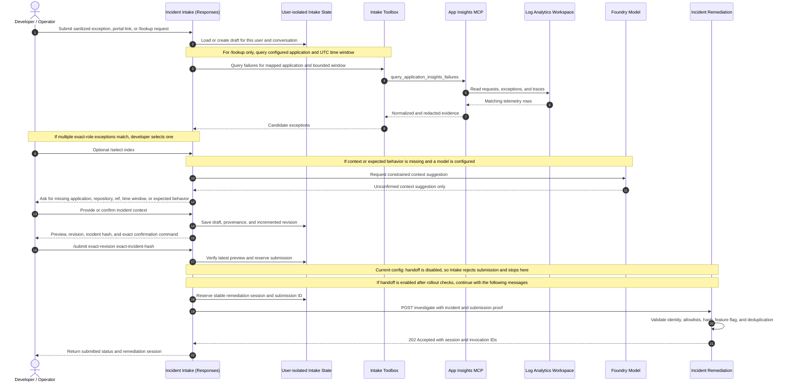
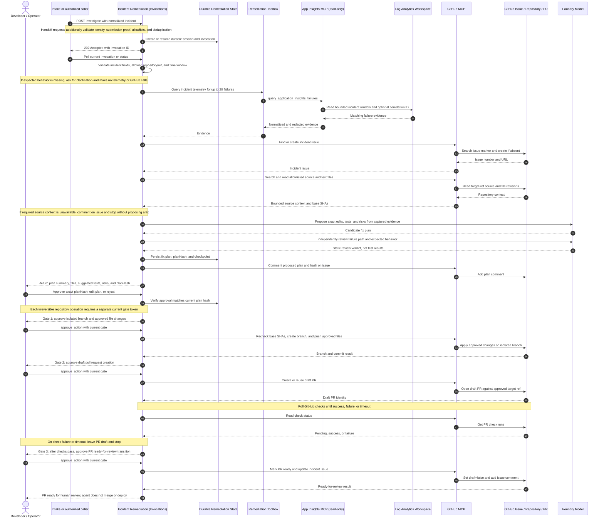

# Incident Remediation PoC: End-to-End Diagrams

These diagrams describe the checked-in Python Incident Intake and Incident Remediation agents and their configured MCP connections. They are logical views, not proof that a specific deployment, identity, connection, or GitHub approval environment is live.

## 1. Incident Intake Sequence

This diagram covers incident preparation, evidence lookup, exact-preview confirmation, and the handoff boundary. The checked-in configuration disables automatic handoff; the dispatch messages are conditional on completing the required rollout checks.

The `/submit` confirmation approves sending the reviewed incident preview. It does not approve a fix. If dispatch is ambiguous, check the reserved session and status rather than automatically sending a second request.

## 2. Incident Remediation Sequence

This diagram begins when the remediation service receives an `investigate` request. The caller can be Intake after handoff is enabled, or a separate authorized invocation for a demo. Incident investigation requires a configured Foundry model for fix generation and static review.

The remediation workflow persists checkpoints and resumes long-running execution from durable state. Rejected gates stop subsequent actions. GitHub check results are the validation signal; the model's proposed test commands are not proof that tests ran.

## 3. High-Level Process Flow: Incident Intake

```mermaid
flowchart LR
    Start([Incident reported]) --> Sanitize[Sanitize exception and remove credentials or personal data]
    Sanitize --> Input{Choose incident input}
    Input -->|Exception export or text| Parse[Parse one exception and extract evidence]
    Input -->|Portal URL| ParseLink[Parse supported URL locally, do not fetch it]
    Input -->|Telemetry lookup| Lookup[Query mapped application and bounded UTC window]
    Lookup --> MCP[Read telemetry through intake toolbox and App Insights MCP]
    MCP --> Select{How many exact-role exceptions matched?}
    Select -->|None| Clarify[Adjust lookup window or provide exception export]
    Clarify --> Input
    Select -->|Several| Pick[Developer selects one exception]
    Select -->|One| Parse
    Pick --> Parse
    ParseLink --> Context[Collect application, repository, deployed ref, time window, and expected behavior]
    Parse --> Context
    Context --> Suggest{Missing context and model configured?}
    Suggest -->|Yes| Proposal[Model suggests context or expected behavior only]
    Proposal --> ConfirmSuggestion[Developer confirms or replaces suggestion]
    Suggest -->|No| Validate
    ConfirmSuggestion --> Validate[Validate required fields, role mapping, allowlists, and time window]
    Validate --> Complete{Valid incident context?}
    Complete -->|No| ClarifyContext[Ask for missing or corrected context]
    ClarifyContext --> Context
    Complete -->|Yes| Preview[Save draft and show preview, provenance, revision, and incident hash]
    Preview --> Review[Developer reviews every preview field]
    Review --> Decision{Confirm exact current revision and hash?}
    Decision -->|Revise| Context
    Decision -->|Decline| Declined([Stop with no submission])
    Decision -->|Confirm| HandoffEnabled{Intake handoff enabled?}
    HandoffEnabled -->|No, current checked-in configuration| Boundary([Stop at preview boundary, no remediation dispatch])
    HandoffEnabled -->|Yes, after rollout checks| Reserve[Reserve incident and stable session once]
    Reserve --> Dispatch[Send investigate request with proof and platform call context]
    Dispatch --> Accepted{Accepted and identifiers verified?}
    Accepted -->|Yes| Submitted([Return session and invocation status])
    Accepted -->|No or ambiguous| Reconcile[Inspect reserved session and status, do not blindly retry]
    Reconcile --> Status[Use read-only status or operator reconciliation]
```

Intake confirmation authorizes submission of the incident preview only. It does not approve a fix. Handoff is disabled in the checked-in intake configuration.

## 4. High-Level Process Flow: Incident Remediation

```mermaid
flowchart LR
    Start([Investigate request received]) --> Admission{Intake handoff request?}
    Admission -->|Yes| ValidateAdmission[Check feature flag, user identity, submission proof, and deduplication]
    Admission -->|No, direct authorized invocation| ValidateIncident[Validate incident fields, repository/ref allowlists, and time window]
    ValidateAdmission --> Admit{Admission accepted?}
    Admit -->|No or conflict| Reject([Reject or reconcile original session])
    Admit -->|Yes| ValidateIncident
    ValidateIncident --> Expected{Expected behavior supplied?}
    Expected -->|No| Ask[Ask for observable expected behavior]
    Ask --> Clarification([Stop before telemetry and GitHub calls])
    Expected -->|Yes| Evidence[Query up to 20 failures through read-only App Insights MCP]
    Evidence --> Issue[Find or create the incident GitHub issue]
    Issue --> Source[Search and capture bounded source/test context on allowed ref]
    Source --> Grounded{Required source context captured?}
    Grounded -->|No| CommentStop[Comment on issue and stop without a fix]
    Grounded -->|Yes| Generate[Generate exact edits, tests, and risks with Foundry model]
    Generate --> Review[Independently review failure path and expected behavior]
    Review --> Supported{Proposal supported by captured evidence?}
    Supported -->|No, retry exhausted or insufficient evidence| CommentStop
    Supported -->|No, correction available| Correct[Correct candidate once from review feedback]
    Correct --> Review
    Supported -->|Yes| Publish[Persist plan and post exact planHash to issue]
    Publish --> HumanPlan{Human decision on current planHash}
    HumanPlan -->|Reject| Stop([Stop, no repository changes])
    HumanPlan -->|Edit| Rehash[Revalidate edits and calculate new planHash]
    Rehash --> Publish
    HumanPlan -->|Approve exact hash| BranchGate{Approve branch and file write?}
    BranchGate -->|Reject| Stop
    BranchGate -->|Approve| CheckBase[Verify captured base revisions are still current]
    CheckBase -->|Stale| Stale([Fail safely, request a new investigation/plan])
    CheckBase -->|Current| Branch[Create isolated branch and apply approved files]
    Branch --> PRGate{Approve draft PR creation?}
    PRGate -->|Reject| Stop
    PRGate -->|Approve| DraftPR[Create or reuse draft PR]
    DraftPR --> CI[Poll GitHub PR checks]
    CI --> Checks{Checks all successful before timeout?}
    Checks -->|No| DraftStop([Leave PR draft, report validation failure])
    Checks -->|Yes| ReadyGate{Approve ready-for-review transition?}
    ReadyGate -->|Reject| Stop
    ReadyGate -->|Approve| Ready[Mark PR ready and update issue]
    Ready --> ReviewPR([Human reviews and merges outside the agent])
```

The agent persists workflow checkpoints and can resume long-running execution. Model-proposed test commands are not proof of execution; GitHub check runs provide the validation signal. The agent does not merge or deploy.

## Configuration Facts To Verify Before Demo

- `INCIDENT_INTAKE_HANDOFF_ENABLED` is set to `false` in the checked-in `azure.yaml`; `ALLOW_INTAKE_HANDOFF` is `true` for the remediation service. The intake flag and required platform identity/admission checks must also pass before the end-to-end dispatch is available.
- Incident `investigate` requires a configured Foundry model for fix generation and static review. The generic offline `action=plan` fallback is not an offline incident-fix flow.
- Verify deployed service versions, application/repository/ref mappings, telemetry and GitHub connections, GitHub permissions, required checks, and human approval configuration separately. The diagrams do not establish live deployment status.
- The agent can prepare a PR for human review; it does not merge or deploy.
