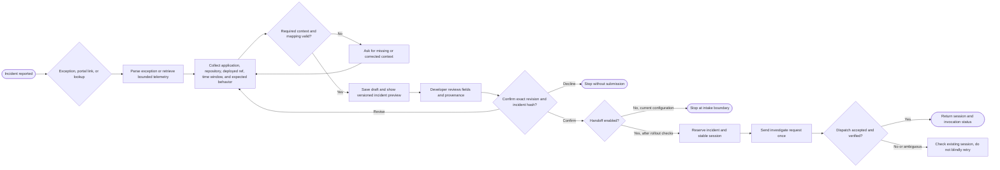

# Incident Remediation PoC: Executive Overview

## Purpose and scope

This document describes the Python hosted-agent workflow under `foundry-agent-python/incident-remediation-hosted/src` and its read-only Application Insights MCP in `app-insights-mcp`. It is based on the checked-in code and configuration, not confirmation of a currently deployed environment.

The existing [DEMO-EXECUTIVE-SUMMARY.md](DEMO-EXECUTIVE-SUMMARY.md) describes a security-scanning and AI pull-request-summary concept. That is a different story from the incident-remediation implementation documented here; do not use it as the architecture or capability description for this PoC.

## The problem

Responding to an application failure can require a developer or operator to move manually between telemetry, incident context, source code, GitHub, and review workflows. The work includes finding the relevant failure, establishing what healthy behavior should look like, locating the responsible code, proposing a change, and producing evidence that the change passed validation. Context can be lost between these steps, while an automatically generated code change without review creates unacceptable risk.

This PoC explores whether agents can reduce that coordination and investigation effort while keeping people in control of repository changes. It does not claim a measured reduction in incident time or a production-ready autonomous repair capability.

## What exists today

| Component | Current role |
| --- | --- |
| Application Insights MCP | A Node.js MCP server with one bounded, read-only failure-query tool. It queries request, exception, and trace records in Log Analytics; limits the time window and result count; normalizes and redacts returned evidence. It does not accept arbitrary KQL or perform writes. |
| Incident Intake agent | A Python Responses agent that accepts exception evidence or performs a bounded telemetry lookup, gathers application/repository/ref context, and prepares a reviewable incident preview. A model may suggest context or expected behavior, but those suggestions remain unconfirmed. Exact-preview confirmation is a separate step from fix approval. |
| Incident Remediation agent | A Python Invocations agent that validates the incident against repository/ref allowlists, gathers telemetry and source context, creates or reuses an issue, and proposes a bounded fix plan. It requires approval of the exact plan before repository changes. |
| Durable workflow state | The remediation workflow uses the Foundry resilient task mechanism and persistent state/checkpoints so long-running work can resume after interruption. The workflow tracks approval and execution state rather than relying only on process memory. |

The components and service wiring are declared in [azure.yaml](foundry-agent-python/incident-remediation-hosted/azure.yaml). The MCP contract and local configuration are described in [app-insights-mcp/README.md](app-insights-mcp/README.md). The detailed operating procedure is in [POC-RUN-GUIDE.md](POC-RUN-GUIDE.md).

## Agent flows

### Intake Process Diagram

1. **Establish a trusted conversation.** The Responses agent requires both a platform-authenticated user and a stable conversation ID. It stores drafts in Foundry state partitioned by user and conversation. Without either identity value, it refuses the request before processing the incident.
2. **Collect one incident signal.** The operator can paste a sanitized exception JSON/text export, provide a supported Azure portal URL, or run `/lookup` with an application and UTC time range. Sanitize inputs before sending: Foundry may retain the original request before agent-side redaction. Portal links are parsed locally and never fetched. A telemetry lookup is constrained to a configured application mapping and a maximum 60-minute window; if multiple exact-role exceptions match, the operator selects one.
3. **Resolve the incident context.** Intake extracts the failure message, stack, timestamp, source, and correlation ID where available. It asks for missing application, repository, deployed ref, time bounds, and expected behavior. It validates the application/repository/ref combination against `applications.json`. A model can suggest context or an observable expected behavior, but it cannot diagnose or propose a code fix; model-suggested expected behavior remains unconfirmed until the operator accepts it or supplies their own.
4. **Review a versioned preview.** Intake creates a normalized incident preview and records provenance. If an exception timestamp is available but no window is supplied, it proposes a window five minutes either side of that timestamp. The preview must include the exception timestamp and fit within the 60-minute limit. Each edit advances the draft revision and changes its incident hash.
5. **Confirm or stop.** The operator must submit the exact `/submit <revision> <incident_hash>` displayed for the latest preview. `/decline` stops an unsubmitted draft. This confirmation authorizes incident submission, which may create a GitHub issue; it is not approval of a remediation plan. Without enabled handoff, submission is rejected and the preview can only be reviewed/exported.
6. **Reserve and hand off once.** When enabled, Intake reserves the incident ID and a stable remediation session before making the request. It sends an `investigate` invocation and forwards the platform call context, but not a user-supplied endpoint. It verifies the returned session/invocation identity. If dispatch is ambiguous or fails, it records/returns an unknown or rejected state and directs the operator to status/reconciliation; it does not automatically retry dispatch. `/status` returns a filtered workflow snapshot when handoff is enabled.

### Remediation Process Diagram

1. **Admit and validate the request.** The Invocations service accepts a new `investigate` request (or the intake handoff wrapper). For handoff, admission requires the feature flag, platform user identity, an incident hash and submission ID matching the incident, a repository/ref in the configured allowlists, and confirmed expected behavior. Duplicate matching submissions reuse their existing admission; conflicting submissions are rejected. The agent returns an invocation ID immediately, and the caller polls for progress/status.
2. **Clarify before side effects when necessary.** Incident normalization validates required fields and a positive time range no longer than 60 minutes. If `expectedBehavior` is missing, the workflow asks for it and performs no telemetry query, issue creation, or fix planning.
3. **Collect evidence and open/update incident tracking.** The agent queries the read-only App Insights MCP for up to 20 failures in the incident window, optionally filtered by the supplied correlation ID. It then finds or creates a GitHub issue for the incident. The issue is tracking/reporting; it is not approval to change code.
4. **Find grounded source context.** Using read-only GitHub tools, it searches the allowlisted repository/ref, prioritizes source locations from the stack and relevant application/test files, and captures bounded complete source files with their revisions. If it cannot capture sufficient source context (including a stack source when one is identified), it comments on the issue and stops without a fix plan, branch, or pull request.
5. **Generate and review a proposed fix.** With a configured Foundry model, the agent proposes a small fix as exact-match edits against captured files, along with tests and risks. It binds the proposal to the captured base revisions, constrains paths and change sizes, and uses a separate model review to check whether the proposed edits address the observed failure path and expected behavior. A rejected candidate can be corrected once; an unresolved or unsupported plan stops rather than proceeding. This review is not test execution.
6. **Publish the plan and pause.** The agent creates a plan containing the repository operations, computes a hash over the plan and fix proposal, records it in durable state, and comments on the issue. It returns the summary, proposed files, suggested tests, risks, evidence count, issue, and `planHash`, then waits. The operator may edit the proposal, which produces a new hash, reject it, or approve the exact current hash.
7. **Gate each repository action.** After exact-plan approval, the workflow pauses separately before each irreversible operation: applying the changes to an isolated branch, opening a draft PR, and marking that PR ready. Each decision must include the current gate's invocation ID, step index, and token. Rejecting a gate halts the remaining work. Before writing, the agent checks that the base files have not changed since planning; a stale plan fails rather than applying to changed source.
8. **Validate and stop at review.** The agent waits for GitHub PR checks between draft creation and the ready-for-review gate. Failed or timed-out checks leave the PR in draft and stop the workflow. After successful checks and the final human approval, it marks the PR ready and updates the incident issue. It does not merge or deploy.

The remediation service also supports a generic `action=plan` workflow that demonstrates approval-gated execution. That is distinct from incident remediation: the incident `investigate` path requires a configured Foundry model for fix generation and review. The generic offline plan fallback must not be presented as an offline incident-fix demo.

## High-Level Workflows

### Incident Intake

Intake confirmation authorizes submission of the reviewed incident preview. It does **not** approve a fix. Handoff is disabled in the checked-in intake configuration.

### Incident Remediation

```mermaid
flowchart LR
    Start([Investigate request]) --> Validate[Validate incident, allowlists, and time window]
    Validate --> Expected{Expected behavior supplied?}
    Expected -->|No| Clarify[Ask for expected behavior and stop before side effects]
    Expected -->|Yes| Evidence[Query bounded App Insights evidence]
    Evidence --> Issue[Find or create incident issue]
    Issue --> Source[Capture bounded source and test context]
    Source --> Grounded{Required source captured?}
    Grounded -->|No| StopEvidence[Comment on issue and stop without a fix]
    Grounded -->|Yes| Proposal[Generate exact-edit fix proposal]
    Proposal --> Review[Independent static review of failure path]
    Review --> Supported{Proposal supported by evidence?}
    Supported -->|No| StopReview[Stop if correction is exhausted or evidence is insufficient]
    Supported -->|Yes| Plan[Publish plan and exact plan hash]
    Plan --> Approval{Human approves current plan hash?}
    Approval -->|Reject| StopPlan([Stop without repository changes])
    Approval -->|Edit| Rehash[Revalidate edits and calculate new hash]
    Rehash --> Plan
    Approval -->|Approve| BranchGate{Approve branch and file changes?}
    BranchGate -->|Reject| StopPlan
    BranchGate -->|Approve| Branch[Create branch and apply approved files]
    Branch --> PRGate{Approve draft PR creation?}
    PRGate -->|Reject| StopPlan
    PRGate -->|Approve| DraftPR[Open or reuse draft PR]
    DraftPR --> Checks[Wait for GitHub checks]
    Checks --> Passed{Checks pass before timeout?}
    Passed -->|No| DraftStop([Leave PR draft and stop])
    Passed -->|Yes| ReadyGate{Approve PR readiness?}
    ReadyGate -->|Reject| StopPlan
    ReadyGate -->|Approve| Ready[Mark PR ready and update issue]
    Ready --> Human([Human review and merge, no agent deployment])
```

The remediation plan approval authorizes only the exact proposed changes. Separate approvals gate the branch write, draft PR creation, and ready-for-review transition. GitHub check results provide validation; the agent does not merge or deploy.

## Safety and control model

- Telemetry access is read-only and constrained to a configured workspace, application, time range, and result limit.
- Incident inputs and telemetry are treated as untrusted evidence, not as instructions. Required context, repository allowlists, target refs, file paths, and change sizes are validated in code.
- The proposed fix is tied to captured repository files and their base revisions. Approval is bound to the exact plan hash; stale source files invalidate the plan.
- Repository-changing actions are separated by human gates. The workflow uses idempotency and durable checkpoints to limit duplicate side effects during retries or recovery.
- GitHub checks must succeed before the PR can be marked ready. Merge and deployment remain separate human-controlled processes.

These controls reduce risk; they do not establish production readiness or guarantee that model proposals are correct. Human review and normal repository protections remain necessary.

## Current state and demo caveats

The repository contains the MCP, the intake and remediation agents, their tests, and local/deployment configuration. Without a Foundry endpoint, the remediation service can use deterministic stand-ins for its generic `action=plan` workflow, but incident `action=investigate` requires a configured Foundry model to generate and review a fix plan. Do not present the generic offline plan as an offline incident-fix demo. Real telemetry and GitHub operations also depend on the appropriate configured services, identities, connections, mappings, and permissions.

The checked-in handoff settings are not symmetric: `INCIDENT_INTAKE_HANDOFF_ENABLED` is set to `false` for the intake service, while `ALLOW_INTAKE_HANDOFF` is set to `true` for the remediation service in `azure.yaml`. As configured, intake does not automatically dispatch to remediation. A demo should either keep the handoff disabled and invoke the remediation flow through the separately documented path, or first complete the required rollout and identity checks. Do not imply the end-to-end handoff is active solely because both services are declared.

The code/configuration review does not verify which agent versions are deployed, whether live App Insights and GitHub connections work, whether allowlists match the intended demo target, or whether required pull-request checks and approval environments are configured. Confirm these before presenting a live end-to-end run. The broader operational and rollout cautions are in the [incident intake README](foundry-agent-python/incident-remediation-hosted/src/incident-intake/README.md) and [run guide](POC-RUN-GUIDE.md).

## Suggested demo narrative

1. Start with a known, sanitized application exception and explain the current manual handoffs between telemetry, source investigation, and change review.
2. Show intake preparing a preview and asking the operator to confirm the application, repository, deployed ref, and observable expected behavior.
3. Show the bounded telemetry evidence and the remediation agent's proposed plan. Make clear that evidence and model suggestions are review inputs, not authoritative conclusions.
4. Approve the exact plan, then show the isolated branch and draft PR workflow, including the pause for repository checks and the separate readiness approval.
5. End at the human review boundary: the agent has prepared a validated PR for review; it has not merged or deployed it.

If intake handoff remains disabled, explain that boundary and start the remediation demonstration through the established manual invocation or GitHub Actions procedure in the run guide. Avoid claiming that the intake-to-remediation dispatch occurred.

## Vision

The intended direction is an observable, reviewable incident-to-pull-request workflow: turn operational evidence into structured incident context, let an agent perform bounded investigation and prepare a proposed change, and preserve clear human decisions at each consequential boundary. The agent should make the work easier to inspect and resume, not replace engineering judgment, code review, or release controls.

Broader use requires verified identity and least-privilege access, trusted application/repository/ref mappings, published and versioned MCP and agent services, privacy-reviewed telemetry handling, evaluation against representative incidents, and an approved recovery and support model.
